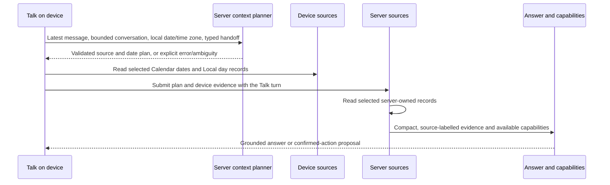

# Talk context selection — proposed architecture

**Date:** 2026-10-19

**Status:** Proposal; this does not describe shipped behavior.

## Problem and boundary

Talk currently sends profile, Goals, Habit history, and up to seven days of
Device Calendar context with an ordinary chat turn. The device chooses Calendar
dates before calling `/ai/chat`, using a default week and date matching over the
latest and earlier user messages. A date missing from that snapshot cannot be
read by the Railway backend: on iPhone, EventKit is the Calendar source. A
`get_daily_context` result with `calendar.status: not_read` therefore means the
device did not supply the requested date. It is not evidence of an empty day.

The target is to send the *evidence needed for this turn*, including its read
state, without relying on a growing set of language-specific date expressions
or filling the answer prompt with unrelated records. Talk remains the only
free-form AI input and the app remains the owner of workflow transitions and
confirmed writes (ADR-0009).

## Recommended turn



The planning call sends **no Calendar events**. It runs after AI consent, uses
server-held credentials, and is billed/observed as part of one user action, not
as a second Talk action. The device sends Calendar content only for dates the
person's request requires. As today, this AI transfer must be disclosed
separately from ordinary on-device Calendar reading (ADR-0020).

### 1. Resolve the request

The planner receives the latest message, a bounded set of recent conversational
turns, the last validated date/topic referent (when one exists), the current
local date and time zone, and any visible typed handoff. The referent is a
pointer to prior user intent, not a cache of assistant claims. Its only job is
to return a typed **read plan**. It does not answer the user, choose a Talk
workflow, execute a write, or infer an event's meaning.

Proposed Zod-owned output:

```text
ContextPlan {
  version: 1
  dateResolution: resolved | ambiguous | not_applicable
  dates: ISO local dates or a bounded inclusive range
  sources: subset of calendar | day | goals | habit_history |
           nutrition | workout | weight | achievements
  referencedTurn: optional conversation message id
  clarification: optional short question when ambiguity changes the read
}
```

The model may select source categories and propose date values. Application
code validates the dates as real local dates, checks range and count limits, and
applies product date semantics (including the user's time zone and Israeli week
boundary). It also enforces source dependencies: a conflict question needs both
Calendar and the day's scheduled Items; a Capacity claim must use the Day
Summary's typed Capacity result. A router cannot remove those required sources.
Longer requested periods are read in bounded batches or narrowed with a visible
question; they are never silently trimmed. `callStructured(schema, prompt) →
Result<T>` is the planner boundary: invalid or failed output is an explicit
error, never a guessed plan.

For example, after “האם יש לי התנגשויות שבוע הבא?”, “וב־26?” should resolve the
date from the active subject and read the 26th; “תבדוק” should retain that
referent. The planner must not treat the latest message in isolation. If “the
26th” has two plausible months, ask once rather than selecting one silently.

### 2. Read authoritative sources

Each source adapter owns its read and status. On iPhone, Calendar is read through
EventKit on the device; the Local day is also device-owned. The backend may read
server-owned records but cannot substitute a hosted Calendar read for EventKit.
The web keeps its own Calendar source behind the same typed adapter; a shared
frontend change must be checked on both web and iPhone.
The answer model sees compact typed results, not a second inferred summary:

```text
Evidence {
  source: calendar | day | ...
  scope: date or range
  status: source-specific ready | empty | not_connected | unavailable | ...
  records: bounded typed records when available
  truncated: boolean when a bound omitted records
}
```

Keep the existing source-specific statuses in the real schema: `connected_empty`
is a successful empty Calendar read, `not_read` means no device read was supplied,
and `unavailable` is a failed read. Never turn one into another. Preserve event
titles verbatim as user data, not instructions or verified external facts.

Daily context should expose only requested modules. A Calendar-only question
needs Calendar evidence, not habit and nutrition lookback or unrelated Daily
Signals. The existing `/ai/daily-context` contract for Today stays intact; Talk
may add narrower read capabilities or a typed projection rather than changing
the Today response.

### 3. Answer and recover missing evidence

The main answer call receives the resolved request, the evidence envelope, and
only relevant instructions/capabilities. It can cite records in its reasoning,
but it cannot claim a date is free when Calendar was `not_read`, `unavailable`,
or truncated. If it discovers that another date or source is needed, it returns
a typed `additional_read_required` request to the application. The application
can ask the device to read that scope and continue the **same** Talk turn within
a bounded retry budget. The server never attempts to read EventKit itself. When
the extra read cannot be completed, Talk states the limitation and asks the user
only if their answer depends on it.

Existing durable workflows keep their application-owned state machine,
confirmation, and tool allowlists. Context selection can later feed a stage's
read-only inputs; it must not become a manager agent that chooses workflow
transitions or executes writes.

## Router choice

Use a provider-neutral `ContextPlanner` adapter behind a Zod schema. Start
with a server-keyed structured model call because the plan needs both a finite
source set and open-ended local dates. Jev or a Decisions API is a candidate for
the finite source-selection portion, but a choice among sources does not by
itself resolve arbitrary dates or conversational references. Adopt a different
router only if the same replay set shows better required-source recall and date
accuracy at acceptable latency and cost. Do not add a second provider as an
architectural dependency before that comparison.

An unambiguous typed handoff date is already resolved input; the planner may
still choose sources, but must preserve that date. A failed planner call is not
silently replaced with the present seven-day snapshot. A deliberate, separately
specified deterministic route for simple typed requests is possible, but its
selection and limitations must be observable.

## Validation and rollout

Build a replay set from consented, redacted real failures plus synthetic Hebrew
and English cases. Include explicit dates, weekdays, Israeli week boundaries,
month rollover, “וב־26?”/“תבדוק” follow-ups, conflicts, a failed EventKit read,
`connected_empty`, and generic events such as “National Day”. Label the required
source and date scope as well as the supported answer. Compare the new path with
the current snapshot path before enabling it for real users.

Primary quality gates are required-source recall, exact date-scope accuracy,
grounded-answer accuracy, and truthful handling of missing/failed evidence.
Also record extra reads, Calendar event bytes sent to AI, input tokens, p95
latency, and cost per Talk action. A missed necessary source is more damaging
than a small amount of extra context, so optimize recall first, then reduce
irrelevant records. Logs may record plan categories, dates, statuses, timings,
and token counts; they must not record user text or Calendar event content.

Roll out in slices: (1) planner schema and offline replay with no behavior
change; (2) Calendar date selection on iPhone behind a flag, retaining the old
path for comparison; (3) source-specific evidence and `additional_read_required`;
(4) expand to other day modules once Calendar quality gates pass. A failed
read remains explicit in every slice. Each behavior slice needs both web and
physical-iPhone checks because the frontend ships on both surfaces.

## Evidence and limits

- [Adaptive-RAG (NAACL 2024)](https://aclanthology.org/2024.naacl-long.389/)
  found benefits from choosing retrieval depth per question on open-domain QA.
- [SELF-multi-RAG (EMNLP Findings 2024)](https://aclanthology.org/2024.findings-emnlp.622/)
  found benefits from resolving conversational context before retrieval.
- [Lost in the Middle (TACL 2024)](https://aclanthology.org/2024.tacl-1.9/)
  found that relevant material buried in long input can be missed.
- [ToolRet (ACL Findings 2025)](https://aclanthology.org/2025.findings-acl.1258/)
  shows that a poor tool selector can lower downstream task success.

These studies motivate selective retrieval and measurement. They do not prove
that this exact design, Jev, or any other router will work on HealthyFlow's
structured device data. The replay and device tests must establish that.
